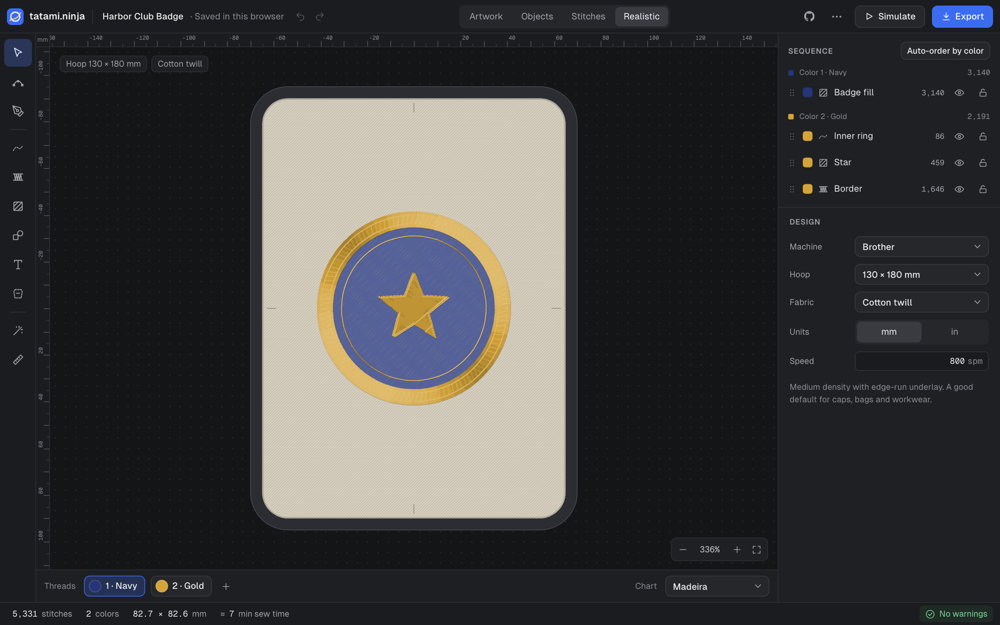
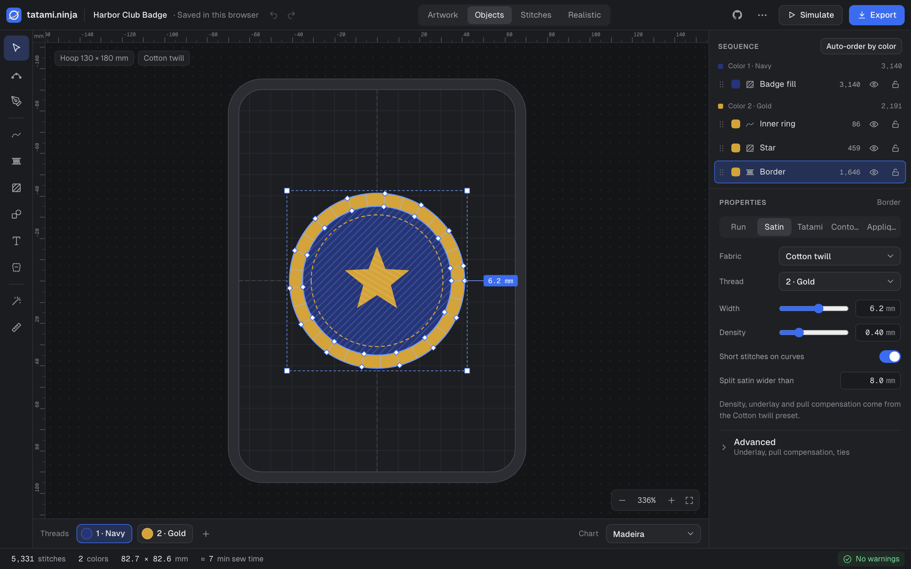
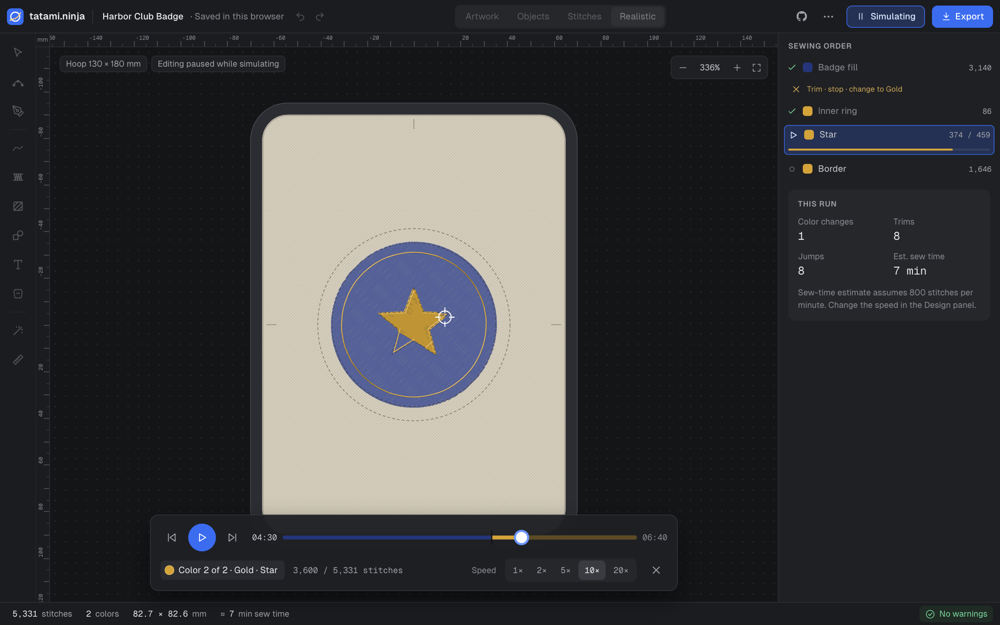
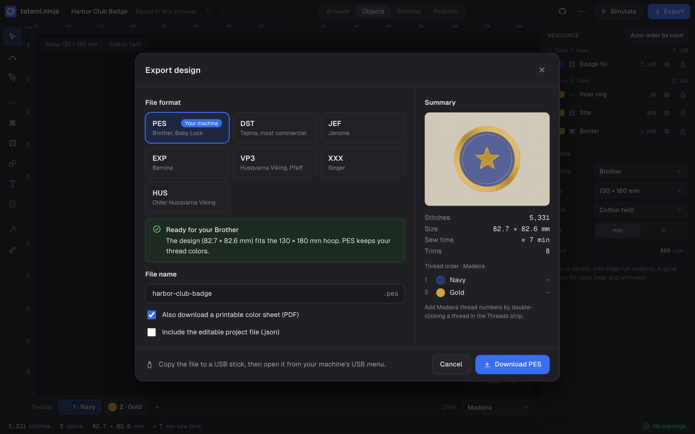
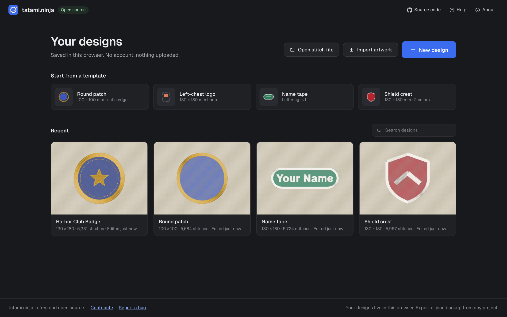

<p align="center">
  
</p>

<h1 align="center">tatami.ninja</h1>

<p align="center">
  <strong>A free, open-source embroidery digitizer that runs entirely in your browser.</strong><br />
  Turn artwork into machine-ready stitch files: no install, no account, nothing uploaded.
</p>

<p align="center">
  <a href="https://tatami.ninja/"><strong>Open the app →</strong></a>
  &nbsp;·&nbsp;
  <a href="https://tatami.ninja/#/help">Help</a>
  &nbsp;·&nbsp;
  <a href="https://github.com/theanam/tatami.ninja/issues">Report an issue</a>
</p>

<p align="center">
  <a href="https://github.com/theanam/tatami.ninja/actions/workflows/ci.yml"></a>
</p>

<p align="center">
  
</p>

## What you can do

- **Bring your artwork.** Import an SVG and every shape becomes stitches: fills, run lines and satin borders, in the SVG's own colors. Or drop in a PNG or JPG and trace over it by hand, or use **Trace image**: it keeps only colors that really occur in the picture (or makes clean black-and-white line art in Threshold mode) and traces at high resolution with sub-pixel accuracy.
- **Edit objects, not stitches.** Switch any shape between run, satin, tatami fill, contour fill and appliqué, then adjust the fill angle, density and stitch length. Stitches regenerate as you work.
- **Draw and letter.** Use pen, satin column, fill and shape tools, with node editing. Type lettering directly on the canvas in any Google Font, picked from a searchable list that previews every family, and set it on an arc if you like.
- **Start from good defaults.** Pick your machine, hoop and fabric (remembered for next time), and the fabric preset sets density, underlay and pull compensation for you.
- **See it before you sew it.** Preview a realistic thread render on your fabric, watch a stitch-out simulation, and get warnings for designs outside the hoop, density hotspots, short stitches and gaps between colors.
- **Export for your machine.** Download PES, DST, JEF, EXP, VP3, XXX or HUS, with a printable color sheet. You can also open existing DST, PES, JEF and EXP files to recolor them.
- **Keep your work private.** Designs autosave in your browser and are never uploaded. Save a design as a `.xtatami` file (⌘S) to back up, share, or keep working on it later with Open file (⌘O).

<table>
  <tr>
    <td width="50%"><br /><sub><b>Objects view.</b> Satin rails and rungs, with live properties.</sub></td>
    <td width="50%"><br /><sub><b>Simulator.</b> Watch the stitch-out at 1–20× speed.</sub></td>
  </tr>
  <tr>
    <td width="50%"><br /><sub><b>Export.</b> Pick a file format and download it, with a printable color sheet.</sub></td>
    <td width="50%"><br /><sub><b>Your designs.</b> Start from a template or pick up where you left off.</sub></td>
  </tr>
</table>

## Supported machines and files

| Format | Machines | Export | Open |
| --- | --- | :---: | :---: |
| PES | Brother, Baby Lock | ✓ | ✓ |
| DST | Tajima, most commercial machines | ✓ | ✓ |
| JEF | Janome | ✓ | ✓ |
| EXP | Bernina | ✓ | ✓ |
| VP3 | Husqvarna Viking, Pfaff | ✓ | |
| XXX | Singer | ✓ | |
| HUS | Older Husqvarna Viking | ✓ | |

Copy the exported file to a USB stick and open it from your machine's USB menu. Always test-sew a new design on a scrap of the same fabric first.

## Quick start

1. Open **[tatami.ninja](https://tatami.ninja/)**, choose **New design**, and pick your machine, hoop and fabric.
2. Choose **Import artwork…** and select an SVG, or draw shapes with the tools on the left.
3. Select objects to fine-tune their stitch type and settings, and drag them in the Sequence list to set the sewing order.
4. Switch to **Realistic**, press **Simulate**, then **Export**.

The in-app [Help page](https://tatami.ninja/#/help) covers every tool and keyboard shortcut.

## Development

You need Node 24 (see `.nvmrc`).

```sh
npm install
npm run dev        # http://localhost:5182
```

| Command | Purpose |
| --- | --- |
| `npm run dev` | Start the dev server on port 5182 |
| `npm test` | Run the unit tests (Vitest) |
| `npm run test:e2e` | Run the end-to-end tests (Playwright; first run `npx playwright install chromium`) |
| `npm run typecheck` | Check types (strict TypeScript) |
| `npm run build` | Build the production site into `dist/` |

The app is built with Vite, React and TypeScript. The stitch engine (`src/engine`) and the file writers (`src/formats`) are pure TypeScript with no DOM access. The engine runs in a Web Worker and is deterministic: the same design always produces the same stitches. Geometry is stored in 0.1 mm units, the native unit of most embroidery formats.

Every push to `main` is tested, built and deployed to [tatami.ninja](https://tatami.ninja/) with GitHub Pages.

## Contributing

Bug reports, ideas and pull requests are welcome. Please [open an issue](https://github.com/theanam/tatami.ninja/issues) to report a problem or discuss a change. For anything else, email [anam.ahmed.a@gmail.com](mailto:anam.ahmed.a@gmail.com).

## Acknowledgements

- [Geist and Geist Mono](https://vercel.com/font) by Vercel (SIL OFL 1.1)
- Lettering fonts: Oswald and Pacifico (SIL OFL 1.1), and Roboto Slab (Apache 2.0). Their license files are in `public/lettering/`.
- File formats follow [pyembroidery](https://github.com/EmbroidePy/pyembroidery) (MIT).
- [Clipper](https://www.npmjs.com/package/clipper-lib), [opentype.js](https://opentype.js.org/) and [jsPDF](https://github.com/parallax/jsPDF).
